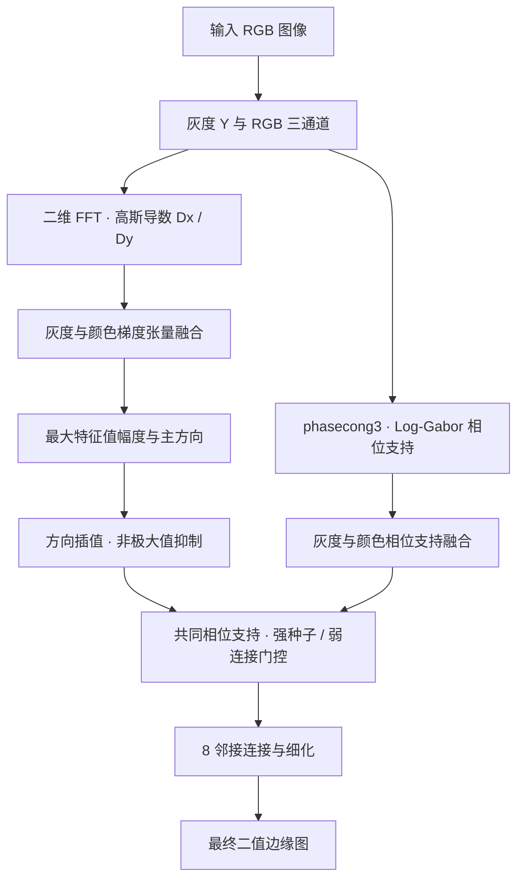

# 基于二维傅里叶变换与相位支持的彩色图像边缘检测及实验分析

**摘要：** 自然图像中的轮廓、纹理和噪声均可能产生高频响应，单纯高通滤波难以兼顾边缘定位与误检控制。本文利用二维傅里叶变换的微分性质实现高斯导数，融合灰度与RGB梯度张量，并结合相位支持、非极大值抑制和双阈值连接提取细边缘。在BSDS500的200张测试图上，冻结配置的Precision、Recall和F1分别为55.38%、65.82%和60.15%，F1较灰度对照提高0.418个百分点。消融结果支持颜色融合与相位支持的固定工作点收益；额外弱连接门控主要改变查准率与查全率的取舍。10图高斯噪声实验中，主方法F1随噪声增强而下降，与灰度方法接近。结果说明普通二维FFT可构建可解释的彩色边缘检测流程，其性能仍受工作点、纹理干扰和评价范围限制。

**关键词：** 二维傅里叶变换；高斯导数；彩色边缘检测；相位一致性；消融实验

# 1 引言

边缘检测需要从图像中提取有意义的强度或颜色变化。自然图像同时包含物体轮廓、表面纹理和光照变化，梯度较大并不意味着一定存在需要保留的轮廓。提高阈值虽然能够减少误检，却也可能使弱边缘消失或断裂。因此，评价边缘检测不能只看线条是否清晰，还要考察查准率与查全率之间的平衡。

经典Canny方法将平滑、梯度、非极大值抑制和连接组织为完整检测流程。对于彩色图像，DiZenzo的向量梯度通过张量描述多个通道沿同一方向的变化；相位一致性则依据不同频率成分的相位关系表征局部特征，为单纯依赖梯度幅值提供补充。近期的非深度学习研究仍在探索颜色与方向信息的融合。例如，Li等于2023年提出M²GF，在Lab空间融合多尺度、多方向Gabor响应；Gao等于2026年结合Gabor、方向增强Sobel和局部一致性，并讨论FFT与可分离卷积的实现。这些工作提供了滤波与融合的研究思路，但其论文成绩不能直接视为本项目统一条件下的对照结果。

本文围绕课程中的卷积定理和微分性质，用普通二维FFT构建彩色边缘检测程序，并通过完整数据集比较、模块消融和有限噪声实验分析各环节的作用。研究重点是数学性质的实现与实验解释。

# 2 原理与 MATLAB 实现

## 2.1 频域高斯导数

设图像为 $I(y,x)$，大小为 $M\times N$，其二维离散傅里叶变换为

$$\hat I(k,l)=\sum_{y=0}^{M-1}\sum_{x=0}^{N-1}I(y,x)\exp\left[-2\pi i\left(\frac{lx}{N}+\frac{ky}{M}\right)\right].$$

FFT是计算DFT的快速算法。卷积定理使空间滤波可以通过频谱相乘实现；微分性质则将方向导数转化为相应频率坐标的乘法。以 $u,v$ 表示列、行方向的频率，单位为 cycles/pixel，高斯频率响应与两个导数算子为

$$H_\sigma(u,v)=\exp[-2\pi^2\sigma^2(u^2+v^2)],\quad D_x=2\pi i uH_\sigma,\quad D_y=2\pi i vH_\sigma.$$

对灰度分量及各颜色通道分别计算 $g_{x,c}=\Re\{\mathcal F^{-1}(\hat I_c D_x)\}$ 和 $g_{y,c}=\Re\{\mathcal F^{-1}(\hat I_c D_y)\}$。其中，频率乘子突出变化，高斯因子抑制过高频率；$\sigma$ 越大，平滑越强，也越可能损失细节。相比直接保留全部高频，这一构造同时考虑了求导与噪声抑制。

程序采用 $\sigma=1.8$ 像素、32像素对称补边，以 `fft2`、`fftshift` 及相应逆操作计算响应后裁回原尺寸。偶数尺寸下，将导数方向的 Nyquist 项置零。该实现采用解析高斯频谱的离散采样，与任意截断空间高斯核并不必然逐像素相同。

## 2.2 灰度与颜色梯度融合

灰度化可能削弱亮度接近、颜色不同的边界，但直接合并三通道二值边缘又容易累积误检。本文在梯度张量层面融合信息。灰度分量 $Y$ 由原 uint8 图像先 `rgb2gray` 再 `im2double` 得到，颜色通道转换至0—1。令 $\mathbf g_c=(g_{x,c},g_{y,c})^\top$，定义

$$J_{RGB}=\frac{1}{3}\sum_{c\in\{R,G,B\}}\mathbf g_c\mathbf g_c^\top,\qquad J=0.75J_Y+0.25J_{RGB}.$$

对 $J=\begin{pmatrix}A&B\\B&C\end{pmatrix}$，取最大特征值的平方根为边缘幅值，主方向为

$$m=\sqrt{\frac{A+C+\sqrt{(A-C)^2+4B^2}}{2}},\qquad \theta=\frac{1}{2}\operatorname{atan2}(2B,A-C).$$

这一构造保留了通道之间的方向关系。程序将方向符号与灰度梯度对齐，沿该方向双线性插值执行非极大值抑制（NMS），保留幅值不小于前向采样、严格大于后向采样的像素，再除以全图原始幅值最大值，得到归一化响应 $N$。全零响应输出零图。当前 RGB 方法仍包含75%的灰度张量分量。

## 2.3 相位支持与弱连接门控

相位一致性关注不同尺度成分在局部特征处的相位关系，而非直接使用原图频谱相角。本文复用 Kovesi 公开的 `phasecong3`，通过多尺度 Log-Gabor 频域滤波计算最大相位一致性矩 $M_c$。设置为4尺度、6方向，最小波长3、尺度倍率2.1、带宽参数0.55、噪声阈值参数4、频率扩展截止0.5、增益10，噪声估计模式为−1。

将灰度及各通道的支持限制在0—1，并用梯度能量融合颜色支持：

$$Q_c=\min\left(\frac{M_c}{0.15},1\right),\qquad w_c=g_{x,c}^{2}+g_{y,c}^{2},\qquad Q_{RGB}=\frac{\sum_{c\in\{R,G,B\}}w_cQ_c}{\max(\sum_c w_c,\varepsilon)},\qquad Q=0.75Q_Y+0.25Q_{RGB}.$$

颜色求和仅包含 R、G、B，零能量处令 $Q_{RGB}=0$。共同相位支持及弱连接响应为

$$S=N(0.75+0.25Q),\qquad S_{seed}=S,\qquad S_{link}=S[1-0.125(1-Q)].$$

强种子由 $S_{seed}\geq0.32$ 确定，弱图由 $S_{link}\geq0.096$ 确定，低高阈值比为0.3。随后用8邻接重建保留与强种子连通的弱响应，再细化至收敛，并将最外一圈置零。所谓保护强种子，是不对其施加额外门控；种子此前仍经过共同相位支持。门控越严格，越可能同时删除误检与真实弱边，因此需要消融判断其实际收益。

**图1RGB频谱与中间响应。固定示例bsds_2018，上行为R、G、B的对数幅度谱，各通道分别归一化，不能据显示亮度比较绝对能量；下行为强种子响应、弱连接门控响应和最终边缘。**

全部实验使用MATLAB R2026b与Image Processing Toolbox，无需GPU。主入口course_fourier_edges依次完成频域导数、张量融合、NMS、相位支持与连接；run_natural_demo提供程序演示入口。

**根据第 2 节方法重建的处理流程（Mermaid；非原文配图）**

# 3 实验设置

采用BSDS500完整200张官方测试图，保留原生321×481或481×321尺寸及全部多人标注。100张验证图在历史实验中已观察，其中12张用于本轮配置选择、88张用于补充验证；200张测试图此前也已观察。因此，以下实验属于冻结配置后的回归与补充分析，不能作为新的盲测。

比较RGB主方法、灰度FFT＋相位、Sobel、Canny、理想高通和高斯高通。灰度对照采用相同导数尺度、相位权重及双阈值，不含颜色融合或额外弱连接门控。Sobel自动阈值乘0.75；Canny的高斯尺度为1.8，低、高阈值为0.096、0.24；两种高通截止频率为0.06cycles/pixel，Otsu阈值乘1.25。Sobel、Canny通过MATLAB接口实现。各方法沿用已冻结配置，历史选参指标和预算存在差异。

评分采用官方匹配器，容差为图像对角线的0.0075倍，`thin=1`，不另裁评分边框。Precision的预测匹配支持取各标注结果并集，Recall则汇总全部标注的匹配计数。设逐图计数为 $c_i^P,n_i^P,c_i^R,n_i^R$，则 $P=\sum_i c_i^P/\sum_i n_i^P$、$R=\sum_i c_i^R/\sum_i n_i^R$，$F_1=2PR/(P+R)$。另报逐图F1的宏平均。此处Precision表示预测边缘的查准率，不等同于像素准确率；人工边缘并集仅用于显示。

采用20000次按图配对bootstrap。主比较中，RGB对5种对照的P/F1共10项使用99.5%双侧区间作Bonferroni校正；消融的5个预定对比×P/F1另作同样校正。Recall及宏平均差值用95%描述区间。噪声比较单独对RGB减灰度/Canny的三档F1共6项使用99.1667%区间，各比较族分别校正。

消融在200张图上设置灰度/RGB与相位关/开的2×2配置，再加入最终门控，统一使用高阈值0.32、低高比0.3。噪声实验固定取测试清单数值ID排序前10张，对0—1的RGB通道独立添加标准差0.02、0.05、0.10的零均值高斯噪声，截断后量化为uint8。种子为42、137、2026加每图固定偏移，同图同种子跨强度共享标准噪声场；所有方法处理同一输入。三个种子的匹配计数先在图内平均，再汇总和重采样，统计单位是10张图，不是30张图。

# 4 结果与分析

## 4.1 完整 200 图对比

表1显示，RGB主方法在六种固定配置中取得最高的Precision和F1，而Canny保留了更高的Recall。RGB主方法P/R/F1的边际95%区间分别为[52.319,58.481]%、[63.914,67.647]%和[58.031,62.228]%。

**表1完整200图固定工作点结果，单位：%。P/R/F1按匹配计数汇总，宏平均F1为逐图平均。**

*（按要求省略表格内具体数值。）*

相对灰度，RGB主方法Precision增加0.877个百分点，99.5%配对区间为[0.682,1.087]；F1增加0.418个百分点，区间为[0.235,0.603]；Recall下降0.252个百分点。相对Canny，Precision增加8.541个百分点，F1增加1.591个百分点，后者区间为[0.462,2.741]，同时Recall低12.281个百分点。因此，本方法的优势表现为更高查准率下的F1平衡，并非全面提高所有指标。

**图2固定示例bsds_3063的原图、人工边界显示并集与六方法结果。所有面板保留原生图幅；评分使用各位标注者的原始边界，并集不作为单一评分标签。该图按数值ID固定，不按性能筛选。**

图2中RGB与灰度结果均保留飞机主要外轮廓，但遗漏部分人工标出的云层边界和机体细节。RGB单图F1约76.8%，低于灰度的77.3%，说明数据集总体收益不保证每图都改善。Canny保留更多边缘的同时也包含更多云层与局部细节响应。该例还表明，“线条更少、更干净”不能单独作为质量更好的依据。

## 4.2 模块消融

表2表明，颜色融合与相位支持在当前工作点分别有F1收益。无相位时，加入颜色使F1增加0.346个百分点；有相位时增加0.397个百分点。灰度和RGB路径加入相位后分别增加0.662、0.713个百分点，四项99.5%配对区间均高于0。

**表2完整200图模块消融，单位：%。尺度及阈值固定，RGB配置的颜色权重均为0.25。**

*（按要求省略表格内具体数值。）*

**图3预定模块对比的配对差值，单位：百分点。依次为无相位时加颜色、有相位时加颜色、灰度加相位、RGB加相位、额外弱连接门控。P/F1为99.5%校正区间，Recall为95%描述区间。**

额外门控的效果更接近工作点调整：Precision增加0.651个百分点，Recall下降0.895个百分点，F1仅增加0.020个百分点，其99.5%区间[−0.111,0.148]跨0。不能据此认定门控独立提高或稳定维持F1。相位支持本身同样使响应衰减，移除模块会改变有效阈值，因而消融只说明固定工作点的差异，不代表每个配置独立调优后的全阈值优势。

主比较与消融中相同掩膜的末位分数略有不同，来自原生匹配器等价匹配选择的微小计数波动，算法及参数未变。表1、表2分别保留本轮原始评分，不能将末位差异解释为算法改进。

## 4.3 高斯噪声实验

同10张图上，RGB主方法在干净、0.02、0.05、0.10噪声条件下的F1依次为65.153%、65.035%、64.425%、63.046%，最高噪声档较干净图下降约2.108个百分点。Precision由65.762%升至67.128%，但Recall由64.556%降至59.431%，反映的是检出减少带来的取舍。

**图4六方法在固定10图上的噪声表现。左图为F1曲线，仅RGB主方法显示边际95%区间带；右图为RGB减灰度/Canny的F1差值及99.1667%校正区间。每图三个种子先平均，bootstrap以图为单位。**

RGB相对灰度的三档F1差值区间均跨0；相对Canny，仅0.02档区间[0.809,3.173]个百分点整体高于0，其余两档跨0。因此，现有实验不支持RGB普遍优于灰度的抗噪结论。两种高通方法在0.10档下降较大，显示仅保留高频容易受到该类退化影响。灰度由同一噪声RGB转换，其实际噪声强度不等于RGB单通道标准差。此外，10图干净F1高于全200图结果是图像范围不同，不能解释为噪声带来提升。

# 5 讨论与结论

本实验用微分乘子求梯度、高斯频响控制尺度，再以颜色张量、相位支持和连接构成检测流程。纹理同样可能具有梯度和相位支持，弱轮廓也可能在平滑或连接中丢失。因此，继续加强筛选可能提高Precision，却未必提高F1。

数据此前已观察，区间不覆盖历史多轮选参的不确定性；旧88图验证未满足全部F1稳定性与Recall要求，后续比较不改变该判断。各对照选参预算不同，当前RGB尚无完整PR/ODS/OIS/AP、全200图噪声、参数敏感性及严格速度基准，故结果仅适用于所列配置，不与异口径文献直接排名。

普通二维FFT可结合彩色联合梯度与相位信息提取自然图边缘。当前200图的Precision、Recall、F1为55.38%、65.82%、60.15%，消融支持颜色融合与相位支持的收益，门控的独立F1收益尚未确认。本文将频域理论与MATLAB实验相联系，后续需以独立数据和全阈值评价检验泛化。
